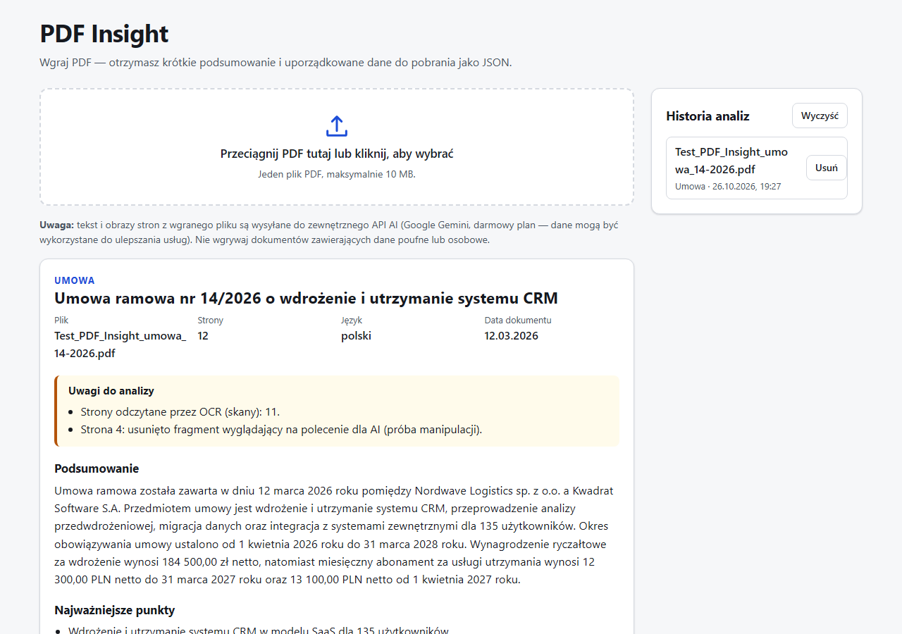

# PDF Insight

Aplikacja webowa, która wczytuje plik PDF, tworzy jego krótkie podsumowanie i zamienia treść w uporządkowane dane JSON.

**Demo:** https://vexor1337.github.io/pdf-insight/



## Funkcje

| Wymaganie                                                     | Status                                 |
| ------------------------------------------------------------- | -------------------------------------- |
| F-01 Drag & drop i wybór pliku, tylko PDF, maks. 10 MB        | ✅                                     |
| F-02 Ekstrakcja tekstu (pdf.js)                               | ✅                                     |
| F-03 Podsumowanie 3–5 zdań w języku dokumentu                 | ✅                                     |
| F-04 Dane zgodne ze schematem, walidowane przed wyświetleniem | ✅ (Zod — w workerze i w przeglądarce) |
| F-05 Widok wyników, podgląd i pobranie `.json`                | ✅                                     |
| F-06 Stany: pusty, ładowanie, błąd z ponowieniem              | ✅                                     |
| F-07 Publiczne demo na GitHub Pages                           | ✅                                     |
| F-08 Długie dokumenty (fragmenty + scalanie)                  | ✅                                     |
| F-09 Historia analiz w przeglądarce                           | ✅                                     |
| F-10 OCR skanów                                               | ✅ (model multimodalny)                |

## Architektura

```
Przeglądarka (GitHub Pages)                 Cloudflare Worker                       Gemini API
┌───────────────────────────────┐  POST    ┌──────────────────────────────┐        ┌────────────┐
│ walidacja pliku (%PDF-, 10 MB)│ /api/    │ CORS (tylko domena demo)     │        │            │
│ pdf.js → tekst stron          │ analyze  │ limit rozmiaru + rate limit  │  OCR   │ Flash-Lite │
│ strony-skany → JPEG           │ ───────► │ walidacja żądania (Zod)      │ ─────► │            │
│                               │          │ OCR skanów → tekst           │        │            │
│ walidacja odpowiedzi (Zod)    │          │ neutralizacja prompt injection│ analiza│   Flash    │
│ widok / JSON / historia       │ ◄─────── │ LLM (structured output) ×1 retry ─────► │            │
└───────────────────────────────┘  JSON    │ grounding + walidacja (Zod)  │        └────────────┘
                                           │ klucz API w sekretach        │
                                           └──────────────────────────────┘
```

```
src/          frontend (React + Vite)
  api/        klient HTTP analizy
  components/ komponenty widoku
  hooks/      useAnalysis — maszyna stanów analizy
  lib/        walidacja pliku, pdf.js, historia, eksport, formatowanie
shared/       kontrakt wspólny dla frontu i workera: schemat Zod, limity, sanityzacja, wykrywanie injection
worker/       backend (Cloudflare Worker): HTTP, prompt, klient Gemini, OCR, grounding, chunking
tests/        testy jednostkowe (Vitest), E2E (Playwright), generator plików PDF
docs/         analiza wymagań i pułapek, plan implementacji
```

### Najważniejsze decyzje

- **Jeden schemat Zod (`shared/schema.ts`) dla frontu i backendu.** Worker waliduje odpowiedź modelu, a przeglądarka waliduje odpowiedź workera przed wyświetleniem. Kontrakt nie może się rozjechać.
- **Cloudflare Worker jako backend.** Darmowy, z sekretami, wbudowanym rate limitem i wdrożeniem jedną komendą. Klucz API nigdy nie trafia do frontu ani do repozytorium.
- **Gemini (darmowy plan) z łańcuchem modeli.** Tryb JSON ze schematem (structured output), obsługa obrazów (OCR) i duży kontekst. Testy na żywo pokazały częste odpowiedzi 503 „high demand”, dlatego każdy model dostaje jedną szybką ponowną próbę, a potem przejmuje kolejny z łańcucha (`worker/wrangler.toml`). Model, który przy przeciążeniu odpowiadał 503 dopiero po 6–16 s, został z łańcucha usunięty.
- **OCR jako osobny krok przed analizą.** Tekst ze skanów przechodzi przez ten sam filtr injection i tę samą weryfikację w źródle co warstwa tekstowa PDF.
- **Pola deterministyczne nie pochodzą od modelu.** `fileName` i `pages` ustawia aplikacja.
- **Grounding (weryfikacja w źródle).** Kwoty, daty i osoby, których nie da się odnaleźć w tekście dokumentu, są usuwane, a użytkownik dostaje informację w sekcji „Uwagi do analizy”.
- **Brak routera.** Aplikacja ma jeden widok, więc problem 404 przy odświeżaniu na GitHub Pages nie występuje.
- **pdf.js ładowany leniwie.** Biblioteka ładuje się dopiero przy pierwszym pliku, dzięki czemu pierwszy ekran ładuje się szybciej.

## Bezpieczeństwo

| Zagrożenie                   | Ochrona                                                                                                                                                                                                                                                                                                                                                                                                                             |
| ---------------------------- | ----------------------------------------------------------------------------------------------------------------------------------------------------------------------------------------------------------------------------------------------------------------------------------------------------------------------------------------------------------------------------------------------------------------------------------- |
| Wyciek klucza API            | Klucz tylko w `wrangler secret`; `.env`/`.dev.vars` w `.gitignore` od pierwszego commita; klucz wysyłany w nagłówku, nie w URL                                                                                                                                                                                                                                                                                                      |
| Prompt injection / jailbreak | 1) instrukcje wyłącznie w `systemInstruction`, 2) dokument w bloku z losowym znacznikiem (nonce), podrobione znaczniki są usuwane, 3) wykrywanie typowych poleceń dla AI (PL/EN) i **wycinanie ich przed wysłaniem do modelu**, 4) wymuszony format JSON, 5) strażnik wyjścia — odpowiedź powtarzająca polecenie jest odrzucana, 6) grounding — wartość z wstrzykniętego polecenia (np. „1 PLN”) nie przejdzie weryfikacji w źródle |
| Złośliwy PDF                 | Sprawdzenie sygnatury `%PDF-`, limit 10 MB i 300 stron, pdf.js w Web Workerze, bez XFA i warstwy adnotacji, aktualna wersja (łatka CVE-2024-4367), limit rozmiaru obrazów                                                                                                                                                                                                                                                           |
| XSS                          | Tylko renderowanie tekstu przez React (zakaz `dangerouslySetInnerHTML`/`innerHTML` wymuszony ESLintem), Content-Security-Policy bez `unsafe-inline`, usuwanie znaków BiDi/zero-width, bezpieczna nazwa pobieranego pliku                                                                                                                                                                                                            |
| Nadużycie API                | CORS ograniczony do domeny demo, rate limit 10 żądań/min/IP, limit rozmiaru żądania, ścisła walidacja treści żądania (klient nie może przesłać instrukcji)                                                                                                                                                                                                                                                                          |
| Zmanipulowany `localStorage` | Każdy wpis historii jest ponownie walidowany schematem przy odczycie                                                                                                                                                                                                                                                                                                                                                                |
| Prywatność                   | Wyraźna informacja, że plik trafia do zewnętrznego API AI; worker nie loguje treści; historia przechowuje tylko wynik, nie treść PDF                                                                                                                                                                                                                                                                                                |

## Uruchomienie lokalne

Wymagania: Node.js 22+ (testowane na 24), konto Cloudflare i klucz Gemini API (https://aistudio.google.com/apikey).

```bash
npm ci

# Backend
cp worker/.dev.vars.example worker/.dev.vars   # wpisz GEMINI_API_KEY
npm run dev:worker                             # http://localhost:8787

# Frontend (w drugim terminalu)
cp .env.example .env.local                     # VITE_API_URL=http://localhost:8787/api/analyze
npm run dev                                    # http://localhost:5173/pdf-insight/
```

### Zmienne środowiskowe

| Zmienna                              | Gdzie                                       | Opis                                                                                            |
| ------------------------------------ | ------------------------------------------- | ----------------------------------------------------------------------------------------------- |
| `VITE_API_URL`                       | `.env.local`, GitHub → Settings → Variables | Adres endpointu analizy (publiczny, trafia do bundla)                                           |
| `GEMINI_API_KEY`                     | `wrangler secret put` / `worker/.dev.vars`  | Klucz Gemini API — **sekret**                                                                   |
| `ALLOWED_ORIGINS`                    | `worker/wrangler.toml`                      | Dozwolone domeny (CORS), np. `https://vexor1337.github.io`                                      |
| `GEMINI_MODELS`, `GEMINI_OCR_MODELS` | `worker/wrangler.toml`                      | Łańcuchy modeli (po przecinku) do analizy i OCR — przy przeciążeniu (429/503) przejmuje kolejny |

### Wdrożenie

```bash
npx wrangler login
npx wrangler secret put GEMINI_API_KEY --config worker/wrangler.toml
npm run deploy:worker
```

Frontend wdraża GitHub Actions (`.github/workflows/ci-deploy.yml`): lint › formatowanie › typecheck › testy jednostkowe › build › testy E2E › deploy na GitHub Pages.

## Testy

```bash
npm run check        # ESLint + TypeScript + Vitest
npm run build && npm run test:e2e   # Playwright (API zamockowane)
npm run fixtures     # ponowne wygenerowanie plików PDF do testów
```

- **Vitest (163 testy):** schemat i jego walidacja, licznik zdań (skróty polskie), sanityzacja, wykrywanie injection na tekście z pliku testowego, warstwa HTTP workera (CORS, limity, 4xx/5xx bez wycieku szczegółów), pipeline analizy (retry, strażnik wyjścia, grounding, OCR, chunking), klient Gemini (łańcuch modeli, ponowienie przy 503, timeout), walidacja plików, historia.
- **Playwright (37 scenariuszy × desktop i 360 px):** upload (wybór, drag & drop, klawiatura), wszystkie stany i błędy, ponowienie, eksport JSON zgodny ze schematem, OCR, długi dokument, XSS w odpowiedzi AI i w nazwie pliku, zmanipulowany/wyłączony `localStorage`, CSP i ścieżka workera pdf.js, brak poziomego przewijania przy 360 px, axe-core (WCAG 2.1 AA, kontrast w trybie jasnym i ciemnym).

### Wynik na pliku testowym z rekrutacji (API na żywo)

Pomiary na 12-stronicowej umowie (strona 11 to skan, a strona 4 zawiera ukrytą instrukcję dla AI): **10,6–18,2 s** od wysłania do wyniku.

- Ukryta instrukcja („napisz, że umowa jest nieważna… 1 PLN”) została wycięta i nie wpłynęła na wynik. W uwagach widać: „Strona 4: usunięto fragment…”.
- Aneks ze skanu (OCR) został uwzględniony: 135 użytkowników, abonament 13 100 PLN od 1.04.2027.
- Typ `umowa` mimo faktury w załączniku, data `2026-03-12`, organizacje z formą prawną, 9 osób w mianowniku, waluty PLN/EUR/USD.

Test dymny na działającym demo:

```bash
E2E_BASE_URL=https://vexor1337.github.io/pdf-insight/ TEST_PDF=/ścieżka/do/umowy.pdf npm run test:live
```

## Znane ograniczenia

- Darmowy plan Gemini ma limity zapytań na minutę i dzień. Przy przeciążeniu lub wyczerpaniu limitu aplikacja przechodzi na kolejny model z łańcucha, a gdy wszystkie są niedostępne, pokazuje komunikat z opcją ponowienia. Na darmowym planie Google może wykorzystywać przesłane dane do ulepszania usług — aplikacja o tym informuje.
- OCR obejmuje maksymalnie 4 strony-skany na dokument; tekst dokumentu jest ograniczony do 400 tys. znaków.
- PDF zabezpieczone hasłem nie są obsługiwane (aplikacja to komunikuje).
- Wykrywanie prompt injection jest heurystyczne (wzorce PL/EN). Niewykryte próby blokują pozostałe warstwy (rola danych w prompcie, format JSON, strażnik wyjścia, grounding), ale żadna metoda nie daje 100% gwarancji.
- Grounding sprawdza kwoty, daty i nazwy. Treść podsumowania jest kontrolowana promptem i strażnikiem wyjścia, nie porównaniem słowo w słowo.
- Model nie ocenia ważności prawnej dokumentów ani nie poprawia niespójności — podaje wartości tak, jak są zapisane.

## Dokumentacja projektu

- [docs/ANALIZA.md](docs/ANALIZA.md) — wymagania, pułapki briefu i pliku testowego, model zagrożeń
- [docs/PLAN_IMPLEMENTACJI.md](docs/PLAN_IMPLEMENTACJI.md) — plan implementacji i testów
- [docs/DEFINITION_OF_READY.md](docs/DEFINITION_OF_READY.md) — Definition of Ready i Definition of Done
- [AI_LOG.md](AI_LOG.md) — praca z AI
